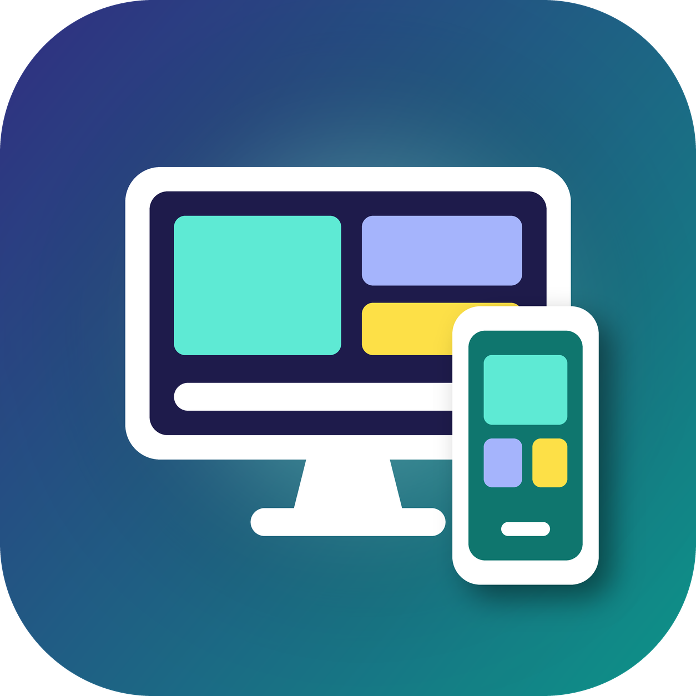

<p align="center">
  
</p>

<h1 align="center">Área de Trabalho Móvel</h1>

<p align="center"><strong>Transforme o seu celular Android em um computador de mesa.</strong><br>
Tela virtual, janelas lado a lado, mouse, teclado e Android Auto, tudo em português.</p>

<p align="center">
  <a href="https://github.com/belchiorjuniorr2/area-de-trabalho-movel/releases/latest"><strong>⬇️ Baixar o APK</strong></a> ·
  <a href="https://area-de-trabalho-movel.vercel.app">🌐 Site do projeto</a> ·
  <a href="https://github.com/belchiorjuniorr2/area-de-trabalho-movel/issues">🐞 Relatar um problema</a>
</p>

> **Área de Trabalho Móvel** é uma versão modificada e traduzida para o português do Brasil do
> [Dextop](https://github.com/NarYuki/Dextop), criado por **NarYuki**. Veja [NOTICE.md](NOTICE.md)
> e a seção [Créditos](#créditos).

A Área de Trabalho Móvel é um app Android de código aberto que cria uma tela virtual e oferece um
ambiente parecido com o de um computador usando apenas o celular. Ela traz um serviço de acesso
privilegiado integrado, que conversa com os serviços do sistema Android para controlar a abertura
de apps, a posição das janelas, o toque, a orientação da tela e outros comportamentos de desktop.

## Capturas de tela

<table>
  <tr>
    <td width="20%" align="center"><br><sub>Início e espaços de trabalho</sub></td>
    <td width="20%" align="center"><br><sub>Área de trabalho</sub></td>
    <td width="20%" align="center"><br><sub>Painel de controle</sub></td>
    <td width="20%" align="center"><br><sub>Várias janelas</sub></td>
    <td width="20%" align="center"><a href="docs/media/dextop-demo.mp4"></a><br><sub>▶ Vídeo de demonstração</sub></td>
  </tr>
</table>

<sub>As capturas e o vídeo vêm do projeto original (Dextop) e mostram a interface antes da tradução.</sub>

## Recursos

- [x] Telas virtuais com resolução, densidade e orientação (retrato ou paisagem) configuráveis
- [x] Controle de tela segura e das decorações do sistema Android
- [x] Menu de apps no estilo desktop
- [x] Espaços de trabalho que salvam e restauram a posição de vários apps
- [x] Layouts com duas, três, quatro janelas e outros
- [x] Importação e exportação de espaços de trabalho em JSON
- [x] Modos de entrada por cursor e por toque direto
- [x] Toque, toque longo, arrastar, clique com o botão direito e gestos com dois e três dedos
- [x] Multitoque, com rolagem e zoom de pinça
- [x] Suporte a mouse físico
- [x] Suporte a teclado físico
- [x] Direcionamento do mouse e do teclado entre o celular e a tela externa (em aparelhos compatíveis)
- [x] Várias telas, com posição dos monitores salva e ponteiro passando de uma tela para outra
- [x] Ocultação automática da barra de tarefas e opção de forçar 120 Hz na tela do aparelho
- [x] Modo notebook para dobráveis, com teclado, trackpad, controle manual e detecção do ângulo da dobradiça
- [x] Gamepad virtual com ABXY, L/R, gatilhos, analógicos, direcional e Start/Select/Home
- [x] Alternância entre a tela principal e a tela externa em dobráveis
- [x] Apps complementares para Android Auto (estacionado e dirigindo), com ajuste automático ao tamanho da central multimídia
- [x] Sobreposição de desempenho com FPS, taxa de atualização, memória, bateria e consumo estimado
- [x] Atalho no painel de Configurações rápidas
- [x] Recuperação de sessões interrompidas e restauração das configurações temporárias do Android
- [x] Relatórios de diagnóstico detalhados (registros, testes de recursos e especificações do aparelho)
- [x] Relatórios de compatibilidade enviados como issue no GitHub deste projeto
- [x] Interface em **português do Brasil** (idioma padrão), além de inglês, japonês, chinês, coreano e russo

## Compatibilidade

| Ambiente | Situação | Observações |
| --- | --- | --- |
| Samsung DeX (One UI 8 ou mais recente) | ✅ Suporte completo | O ambiente mais completo hoje. Os recursos gerenciados pelo DeX usam a implementação da própria Samsung. |
| Samsung DeX (anterior à One UI 8) | ⚠️ Limitado, provavelmente incompatível | Versões antigas do DeX podem não ter o comportamento de tela e janelas que o app precisa. |
| Google Pixel | 🟡 Limitado e incompleto | Depende do modo de janelas livres/desktop do Android e das APIs ocultas disponíveis. |
| OPPO ColorOS | 🟡 Limitado e incompleto | A área de trabalho aparece, mas componentes como a barra de tarefas podem não aparecer. |
| Xiaomi com HyperOS ou mais recente | ❌ Não suportado | MIUI e HyperOS não são suportados. |
| Outros aparelhos Android | 🧪 Experimental | O suporte a tela virtual, espelhamento e janelas livres varia por fabricante, modelo e atualização. |

O app testa os recursos do aparelho ao abrir e tenta os métodos compatíveis em ordem. Como ele depende
de APIs ocultas do Android e do comportamento de cada fabricante, os resultados podem mudar entre
modelos e versões do sistema, mesmo da mesma marca. A lista detalhada de aparelhos testados pela
comunidade do projeto original está na [wiki do Dextop](https://github.com/NarYuki/Dextop/wiki/Device-Compatibility).

## Requisitos

- Android 11 ou mais recente. Na maioria dos aparelhos, Android 14 ou mais recente é necessário para um desktop utilizável.
- Versão atual: **Área de Trabalho Móvel 1.0.0** (baseada no Dextop 1.7.1).
- Não precisa de root. O app já traz o serviço de acesso necessário; o Android pode pedir permissões
  ou o pareamento da **Depuração por Wi-Fi** durante a configuração.
- Root, Stellar, Shizuku e outros serviços privilegiados compatíveis continuam funcionando. Se algum
  já estiver disponível, o app detecta e usa automaticamente.

## Instalação

1. Baixe o APK mais recente em [Releases](https://github.com/belchiorjuniorr2/area-de-trabalho-movel/releases/latest).
2. Abra o arquivo no celular e permita a instalação de fontes desconhecidas, se o Android pedir.
3. Abra a **Área de Trabalho Móvel** e siga o assistente de configuração (acessibilidade e pareamento).

> O APK é assinado com uma chave própria deste projeto, diferente da chave do Dextop original. Por
> isso ele é instalado como um app separado (`br.com.belchior.areadetrabalhomovel`) e pode conviver
> com o Dextop no mesmo aparelho.

## Android Auto

O suporte ao Android Auto usa dois apps complementares: **Estacionado** (tela cheia com toque completo
quando o carro está parado, Android 15+) e **Dirigindo** (usa a Android for Cars App Library, Android 13+,
com o celular servindo de trackpad e teclado). Nesta primeira versão em português os apps complementares
**não** são publicados no release; eles podem ser compilados a partir do código (`./gradlew :cardex:assembleRelease`).
Os detalhes de instalação estão no [README original](docs/README.original.en.md#android-auto-quick-start).

## Desenvolvimento

```sh
git clone https://github.com/belchiorjuniorr2/area-de-trabalho-movel.git
cd area-de-trabalho-movel
flutter pub get
flutter analyze
flutter test
flutter build apk --flavor github --debug --dart-define=DISTRIBUTION_CHANNEL=github
```

Versão do Flutter usada: **3.41.6** (Dart 3.11). As traduções ficam em `lib/l10n/app_*.arb`; o
português do Brasil (`app_pt_BR.arb`) é o arquivo modelo. Depois de editar um ARB, rode
`flutter gen-l10n` e `python3 tool/generate_native_strings.py` para atualizar as strings nativas do Android.

Para assinar um build de release, copie `.env.example` para `.env` e preencha os valores `DEXTOP_*`
com a sua própria chave. Nunca envie a chave ou o `.env` para o repositório.

## Diagnóstico e relatórios de aparelho

- **Configurações → Informações do app → Registro de operação e diagnóstico do aparelho**: veja, copie ou
  compartilhe as especificações do aparelho, os testes de recursos e os registros do app.
- **Configurações → Relatório do aparelho**: marque o resultado de cada recurso e toque em
  **Enviar relatório pelo GitHub**. O app abre uma issue pré-preenchida neste repositório para você
  revisar antes de enviar. Apague qualquer informação pessoal que não queira publicar.

Esta versão **não** envia telemetria: o Firebase Analytics do projeto original foi removido.

## Documentação original

A documentação do projeto original continua disponível (em outros idiomas):
[English](docs/README.original.en.md) · [日本語](README.ja.md) · [简体中文](README.zh-CN.md) · [한국어](README.ko.md) ·
[Wiki do Dextop](https://github.com/NarYuki/Dextop/wiki).

## Créditos

- **Projeto original:** [Dextop](https://github.com/NarYuki/Dextop), de **NarYuki** e colaboradores,
  licenciado sob GPL-3.0. Todo o motor do app (tela virtual, espelhamento, Plasma, Linux, Android
  Auto etc.) é trabalho do projeto original.
- **Tradução para pt-BR, nova identidade visual, site e esta distribuição:** José Belchior.
- Bibliotecas e componentes de terceiros: veja a pasta [`third_party/`](third_party) e a tela
  **Licenças de código aberto** dentro do app.

## Licença

GPL-3.0-or-later, a mesma do projeto original. Veja [LICENSE](LICENSE) e [NOTICE.md](NOTICE.md).
Esta é uma versão modificada; ela não é afiliada, endossada nem mantida por NarYuki.
